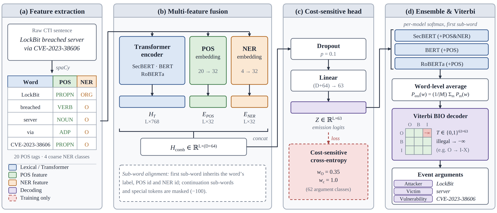
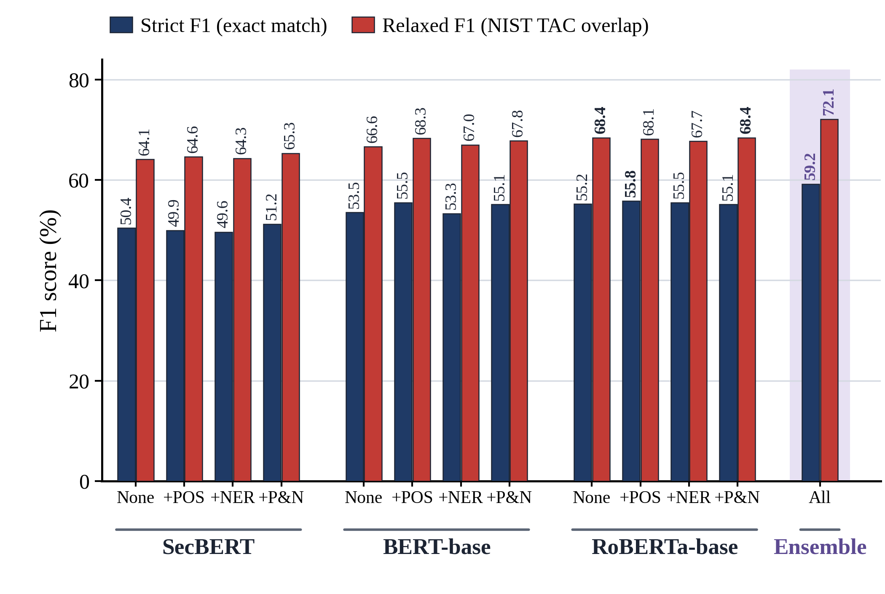

# Enhancing Cybersecurity Event Information Extraction via Multi-Feature Transformer Embeddings and Constrained Transition Decoding

[](https://www.python.org/downloads/)
[](https://pytorch.org/)
[](https://huggingface.co/docs/transformers/)
[](https://spacy.io/)
[](LICENSE)

An end-to-end neural sequence labeling and ensembling pipeline for automated **Cybersecurity Event and Argument Extraction (EAE)** on the benchmark **CASIE dataset (AAAI 2020)**.

---

## 📌 Overview

Mining unstructured Cyber Threat Intelligence (CTI)—such as threat reports, incident disclosures, and vulnerability bulletins—is essential for rapid threat modeling and vulnerability mitigation. However, token classification in cybersecurity text suffers from:
1. **Severe Class Imbalance**: Non-argument background words (`O` tags) exceed 80–85% of all tokens.
2. **Span Boundary Fragmentation**: Complex multi-word phrases (e.g., *'Remote Code Execution Vulnerability'*, *'Lazarus hacking group'*) are frequently truncated or split.
3. **Domain Vocabulary vs. Syntactic Generalization**: Specialized models (SecBERT) excel at technical jargon but often struggle with intricate compound syntax, whereas general PLMs (RoBERTa, BERT) excel at syntax.

### 💡 Core Contributions & Methodologies
* **Multi-Feature Late Fusion**: Concatenates Transformer contextual hidden states ($D = 768$) with dense Part-of-Speech ($E_{\text{pos}} \in \mathbb{R}^{32}$) and coarse General Named Entity Recognition ($E_{\text{ner}} \in \mathbb{R}^{32}$) embeddings:
  $$\mathbf{h}_{\text{comb}} = [\mathbf{h}_T \,;\, \mathbf{e}_{\text{pos}} \,;\, \mathbf{e}_{\text{ner}}] \in \mathbb{R}^{D + 64}$$
* **Cost-Sensitive Learning**: Penalizes the background negative class ($w_O = 0.35$) while maintaining unit weight ($w_c = 1.0$) across all 62 positive trigger and argument classes, boosting event recall without conservative bias.
* **Viterbi Constrained BIO Decoding**: Implements a Boolean validity trellis masking 1,891 illegal pairwise BIO transitions (47.6% of the transition space), structurally eliminating span boundary errors (e.g., `O -> I-Tag`).
* **Multi-Model Word-Level Softmax Ensemble**: Bridges subword tokenizer discrepancies (WordPiece vs. BPE) by averaging Softmax probability distributions at the word level across 12 model configurations spanning SecBERT, BERT-base, and RoBERTa-base:
  $$P_{\text{ensemble}}(w) = \frac{1}{|M|} \sum_{m \in M} P_m(w)$$

---

## 🏗️ System Architecture



---

## 📊 Experimental Results (Ablation Study)

Evaluated on the official CASIE test split (100 articles, 1,714 sentences, 3,682 entity spans) under both **Strict Exact Match** (exact boundaries & role label) and **Relaxed NIST TAC Overlap** (AAAI 2020 standard):

| Model Backbone | Feature Setup | Accuracy (%) | Precision (%) | Recall (%) | **Strict F1 (%)** | Relaxed Prec (%) | Relaxed Rec (%) | **Relaxed F1 (%)** |
| :--- | :--- | :---: | :---: | :---: | :---: | :---: | :---: | :---: |
| **SecBERT** | None | 84.0 | 42.2 | 62.4 | 50.4 | 53.7 | 79.5 | 64.1 |
| **SecBERT** | +POS | 84.1 | 42.0 | 61.4 | 49.9 | 54.4 | 79.5 | 64.6 |
| **SecBERT** | +NER | 83.9 | 41.4 | 61.9 | 49.6 | 53.6 | 80.2 | 64.3 |
| **SecBERT** | +POS&NER | 84.5 | 43.7 | 61.7 | **51.2** | 55.8 | 78.8 | **65.3** |
| **BERT-base** | None | 83.9 | 44.1 | 68.0 | 53.5 | 54.9 | 84.6 | 66.6 |
| **BERT-base** | +POS | 85.4 | 47.0 | 67.5 | **55.5** | 58.0 | 83.2 | **68.3** |
| **BERT-base** | +NER | 84.0 | 43.8 | 68.2 | 53.3 | 55.0 | 85.6 | 67.0 |
| **BERT-base** | +POS&NER | 84.9 | 45.9 | 68.7 | 55.1 | 56.6 | 84.7 | 67.8 |
| **RoBERTa-base** | None | 85.5 | 48.3 | 64.4 | 55.2 | 59.9 | 79.8 | **68.4** |
| **RoBERTa-base** | +POS | 84.6 | 46.3 | 70.1 | **55.8** | 56.5 | 85.5 | 68.1 |
| **RoBERTa-base** | +NER | 84.2 | 45.8 | 70.4 | 55.5 | 55.9 | 85.9 | 67.7 |
| **RoBERTa-base** | +POS&NER | 84.6 | 45.7 | 69.3 | 55.1 | 56.8 | 86.0 | **68.4** |
| **ENSEMBLE (All)** | Multi-Backbone | **86.6** | **51.1** | **70.3** | **59.2** | **62.3** | **85.7** | **72.1** |



> **Key Takeaway**: The multi-model word-level ensemble pushes Strict F1 to **59.2%** (+3.4 pp over best single model) and Relaxed F1 to **72.1%** (+3.7 pp over best single model), driven by consensus filtering that increases precision to **51.1%** (+4.8 pp).

---

## 📁 Repository Structure

```text
NLP_project/
├── step1_data_preparation.py        # [Step 1] Tokenization, POS & General NER extraction
├── step2_train_experiments_v3.py    # [Step 2] PyTorch model training & late-fusion pipeline
├── step3_evaluate_experiments_v3.py # [Step 3] Strict / Relaxed evaluation & ensemble engine
├── step4_interactive_app.py         # [Step 4] Terminal CLI interactive CTI extractor
├── step5_web_app.py                 # [Step 5] Interactive Gradio Web Dashboard
├── verify_dataset.py                # Dataset validation & leakage verification script
│
├── dataset/                         # Processed datasets and categorical mappings
│   ├── feature_mappings.json        # Combined POS and General NER mapping IDs
│   ├── label_mapping.json           # 63 fine-grained BIO label mappings
│   ├── pos_mapping.json             # 20 Universal POS category IDs
│   ├── ner_gen_mapping.json         # 21 OntoNotes 5.0 coarse NER category IDs
│   ├── train.json                   # Processed training split (800 articles)
│   ├── val.json                     # Processed validation split (100 articles)
│   └── test.json                    # Processed official test split (100 articles)
│
├── notebooks/                       # Interactive Jupyter Notebooks
│   ├── Run_Experiments_v3_Ultra_Colab.ipynb # Google Colab GPU training notebook
│   └── Evaluate_Models_Local.ipynb          # Local evaluation & visualization notebook
│
├── test/                            # Unit tests and modular pipeline demos
│   ├── bio_tagging_demo.py          # Demo of BIO sequence labeling mechanics
│   ├── evaluation_demo.py           # Demo of Strict vs. Relaxed evaluation algorithms
│   ├── merge_spans_demo.py          # Demo of event trigger and argument span merging
│   └── subword_alignment_demo.py    # Demo of WordPiece/BPE subword label alignment
│
├── figures/                         # High-resolution architectural figures & charts
│   ├── system_architecture.png
│   ├── ablation_f1_comparison_chart.png
│   ├── all_12_models_loss_curves.png
│   └── validation_loss_comparison_by_backbone.png
│
├── results/                         # Evaluation artifacts & ablation tables
│   └── master_ablation_results_v3.csv
│
├── requirements.txt                 # Project dependencies
└── .gitignore                       # Git exclusion rules (ignores heavy model weights)
```

---

## 🚀 Getting Started

### 1. Environment Setup

```bash
# Clone the repository
git clone https://github.com/your-username/cybersecurity-event-extraction.git
cd cybersecurity-event-extraction

# Create and activate a virtual environment
python -m venv venv
source venv/bin/activate  # On Windows: venv\Scripts\activate

# Install dependencies
pip install -r requirements.txt

# Download required spaCy language pipeline
python -m spacy download en_core_web_sm
```

### 2. Dataset Verification

```bash
python verify_dataset.py
```
> Confirms dataset alignment across tokens, Universal POS tags, OntoNotes NER tags, and BIO ground truth, confirming 0% data leakage across official splits.

### 3. Training Models

Train any backbone with auxiliary features via CLI:

```bash
# Train RoBERTa with POS Tag embeddings
python step2_train_experiments_v3.py \
    --model_name roberta-base \
    --features POS \
    --epochs 10 \
    --lr 2e-5 \
    --batch_size 16 \
    --o_weight 0.35

# Train SecBERT with joint POS and General NER features
python step2_train_experiments_v3.py \
    --model_name jackaduma/SecBERT \
    --features POS_NER \
    --epochs 10 \
    --lr 2e-5 \
    --batch_size 16 \
    --o_weight 0.35
```

Alternatively, use [notebooks/Run_Experiments_v3_Ultra_Colab.ipynb](notebooks/Run_Experiments_v3_Ultra_Colab.ipynb) to train on Google Colab GPU.

### 4. Evaluation and Multi-Model Ensembling

```bash
# Evaluate all trained checkpoints on the CASIE test set
python step3_evaluate_experiments_v3.py --all

# Run multi-model word-level softmax ensemble
python step3_evaluate_experiments_v3.py --ensemble
```

### 5. Interactive CLI Extractor

Test extraction on custom unstructured threat texts:

```bash
python step4_interactive_app.py
```

### 6. Interactive Web Dashboard

Launch a local Gradio web application with highlighted entity extraction and structured threat intelligence summaries:

```bash
python step5_web_app.py
```

---

## 📚 References & Citation

If you find this work or the CASIE benchmark useful in your research, please cite:

```bibtex
@inproceedings{satyapanich2020casie,
  title     = {CASIE: Extracting Cybersecurity Event Information from Text},
  author    = {Satyapanich, Taneeya and Ferraro, Francis and Finin, Tim},
  booktitle = {Proceedings of the AAAI Conference on Artificial Intelligence},
  volume    = {34},
  number    = {05},
  pages     = {8749--8757},
  year      = {2020},
  doi       = {10.1609/aaai.v34i05.6401}
}
```

---

## 📄 License
This repository is released under the [MIT License](LICENSE).
